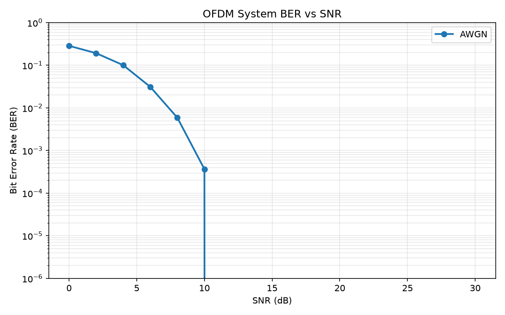
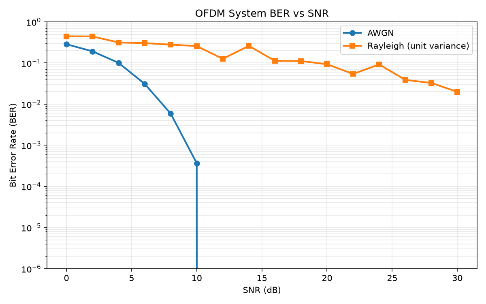

# Wireless Communications

Coursework for **Wireless Communications** at the University of Tehran, School of Electrical and Computer Engineering.

**Abbas Khoshdooni Farahani**

Computer assignment 2 is a software OFDM link. The notes follow the submitted report: the chain, the parameters, and the numbers below are the ones from that simulation. The code is the submitted Python, with the comments in English.

```bash
pip install -r requirements.txt
python main.py
```

`main.py` repeats the four parts and writes `results/`. The plots and `results/summary.json` already in the repository are the submitted run (3 trials at each SNR). A new run uses different seeds only where the trial index changes the seed, so part A and part D match this file; the BER curves match as well when `n_trials=3`.

## Link

| Item | Value |
| --- | --- |
| IFFT / FFT length | 1024 |
| Data subcarriers | 400 |
| Cyclic prefix | 256 samples (25% of the IFFT) |
| Modulation | QPSK with column-wise DPSK, alphabet size 4 |
| Payload | 8192 QPSK symbols (16384 bits) |
| Symbols per subcarrier | 21, plus one DPSK reference row |
| Padding symbols | 208 |
| One data frame | 28160 samples |
| Packet | 8 header frames, the data frame, 8 header frames (478720 samples) |

The transmitter maps bit pairs to QPSK indices \(\{0,1,2,3\}\), prepends a reference row, and encodes each subcarrier differentially:

\[
y[n] = (x[n] + y[n-1]) \bmod 4
\]

Differential detection does not need the absolute channel phase. The symbols sit on bins 1 through 400. The matching negative bins hold the complex conjugate, and DC stays zero, so the IFFT is real. A cyclic prefix is copied from the end of each OFDM symbol. The packet is wrapped with a known header, eight copies at the start and eight at the end.

The receiver strips the header, removes the prefix, takes the FFT, keeps the 400 data bins, decodes the differential symbols, and maps the nearest QPSK phase back to bits.

Noise follows \(\sigma = \sigma_s / \sqrt{\mathrm{SNR}}\), where \(\sigma_s\) is the standard deviation of the transmitted waveform and SNR is linear. On the Rayleigh channel each OFDM symbol (IFFT plus prefix) is multiplied by one coefficient \(h \sim \mathcal{CN}(0,1)\). The receiver divides by that coefficient (zero forcing, perfect channel knowledge) and keeps the real part.

## Part A — AWGN at 20 dB

One packet, 16384 bits, SNR fixed at 20 dB. The bit error rate is 0.

## Part B — BER on AWGN

SNR from 0 dB to 30 dB in steps of 2 dB. Each point is the mean of 3 independent runs.

| SNR (dB) | BER |
| --- | --- |
| 0 | 0.287 |
| 2 | 0.193 |
| 4 | 0.101 |
| 6 | 0.0312 |
| 8 | 0.00590 |
| 10 | 3.66×10⁻⁴ |
| 12–30 | 0 |

The curve falls as the SNR rises and is zero from 12 dB upward for this payload. That is the expected shape for differential QPSK on AWGN.



## Part C — BER on block Rayleigh fading

Same sweep, with zero-forcing equalization. The Rayleigh curve stays well above the AWGN curve. At 30 dB the BER is still about 0.020.

| SNR (dB) | BER |
| --- | --- |
| 0 | 0.446 |
| 2 | 0.443 |
| 4 | 0.316 |
| 6 | 0.304 |
| 8 | 0.280 |
| 10 | 0.258 |
| 12 | 0.127 |
| 14 | 0.261 |
| 16 | 0.113 |
| 18 | 0.112 |
| 20 | 0.0938 |
| 22 | 0.0542 |
| 24 | 0.0925 |
| 26 | 0.0389 |
| 28 | 0.0328 |
| 30 | 0.0199 |

The decay is slow, and it is not monotone, because three trials are not enough to average out deep fades. When \(|h|\) on a symbol is very small, dividing by \(h\) amplifies the noise on that symbol and those bits are lost regardless of the average SNR. A practical link on this channel needs diversity or channel coding. Zero forcing with perfect CSI does not remove that.



## Part D — synchronization

A noise prefix of unknown length (at most 5000 samples) is added in front of the packet, then the packet goes through AWGN at 20 dB. The receiver correlates against one header frame and takes the first peak that reaches 85% of the maximum. That selects the leading header rather than the copy at the end of the packet.

On the submitted run the true delay was 2028 samples, the estimate was 2028 samples, and the bit error rate after alignment was 0.
